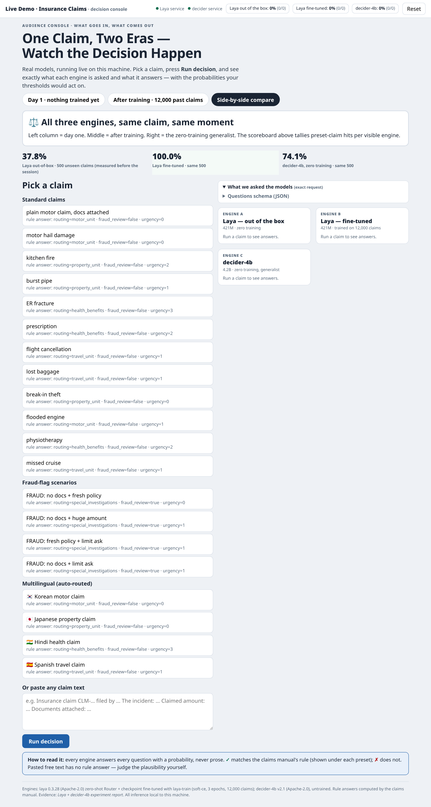
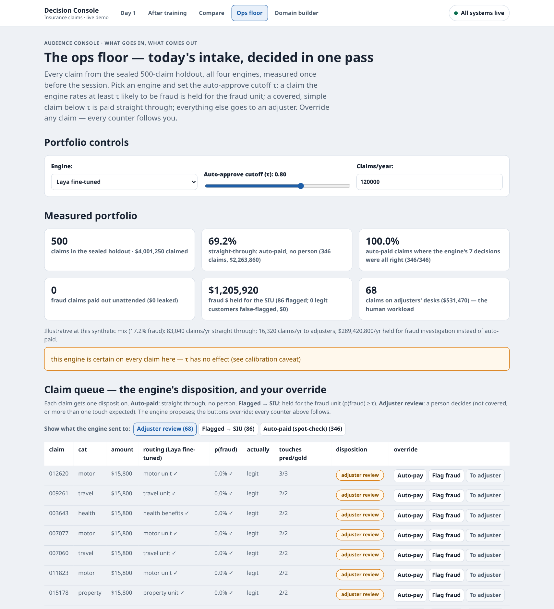
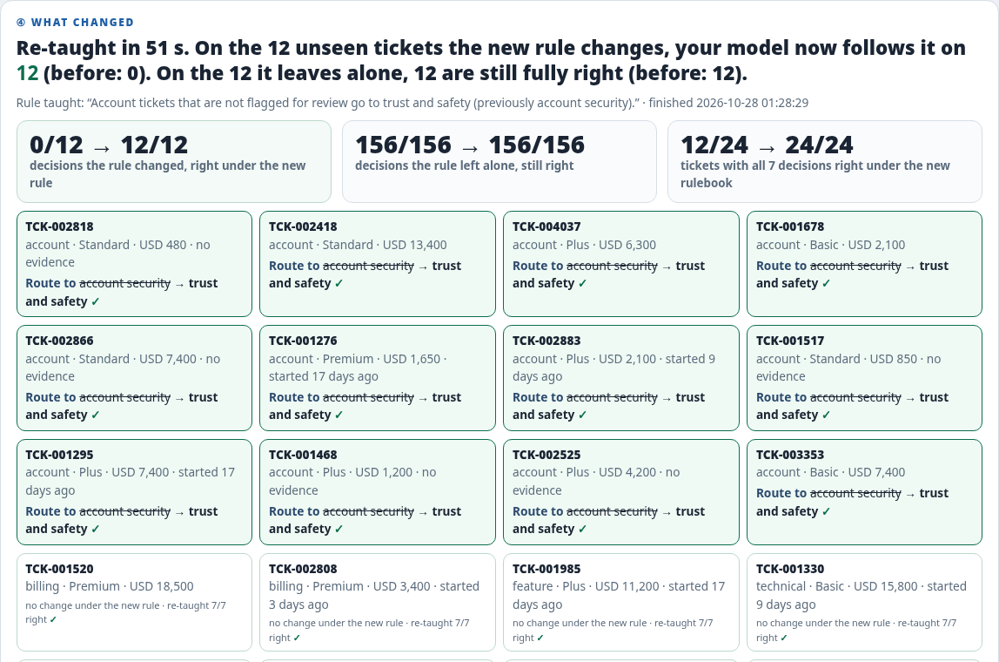

# Decision Models Study & Live Demo — Laya + decider-4b vs CLM-8B

[](https://github.com/lunarpulse/decision_models_study/actions/workflows/ci.yml)

A reproducible study and an audience-facing live demo of open-weight **decision models**
(System-One style: typed questions in, calibrated probabilities out — never generated prose)
on an insurance-claims journey, anchored on a sealed-evaluation comparison against CLM-8B.

- **Live demo**: pick a claim, watch four engines answer a 7-decision claim journey with probabilities,
  press one button to go from "untrained" (46.4% avg per decision) to "trained on 12,000 claims"
  (100.0% on the in-template holdout); ops floor; Domain Builder (change one rule of a business's
  rulebook, re-teach its model live in about a minute, compare old vs new on any case).
- **Full study evidence**: sealed-split evaluation, serving matrix, GGUF quantization gate,
  option-order controls, calibration analysis, retained-failure ledger — all measured, nothing
  vendor-quoted without a label.



## Quickstart

```bash
bash setup.sh                     # creates .venv-laya and .venv-decider (uv or python -m venv)
cd demo-insurance
bash train_laya.sh                # ~15 min on an RTX 5090 (measured 923.5 s); fine-tunes on the 12k-claim corpus
python build_portfolio.py         # ~2 min; measures all engines on the sealed 500-claim holdout
                                  # (also regenerates stats.json and the ops-floor data)
bash train_prod_ckpt.sh           # ~7 min per business; the Domain Builder's production models
bash start_demo.sh                # → http://127.0.0.1:8901/?mode=day1
```

Optional supervised-parity arm (what happens if you fine-tune the decider too?):
```bash
cd demo-insurance
python train_decider_ft.py        # LoRA r64 on the same 12k corpus (~1-2 h, 8.4 GB weights)
python eval_presets.py decider-ft-ckpt/model   # 20-preset verdict table, before vs after
```

Optional public URL: `cloudflared tunnel --url http://localhost:8901` (see `demo-insurance/DEMO_MANUAL.md`).
**Warning:** the demo has no authentication — anyone with the URL can run inferences on your GPU.

## Requirements

| Need | Minimum | Notes |
|---|---|---|
| OS | Linux (tested on CachyOS) | macOS should work (Metal) — untested |
| Python | 3.11–3.13 | setup.sh defaults to 3.12 |
| GPU | CUDA, ≥12 GB free (16+ GB rec.) | **CPU-only**: set `DEVICE=cpu` for the Laya service (~230 ms/decision); decider needs the GGUF arm — `pip install "decider-ai[gguf]"` plus `DECIDER_MODEL` pointing at `Mapika/decider-4b-GGUF` (~5 s/decision on 8+ cores) |
| Disk | ~20 GB peak | wheels + models (`convaiinnovations/laya` ~2.5 GB, `Mapika/decider-4b` ~8 GB), both auto-download from Hugging Face on first run |
| Ports | 8901, 8902 | configurable via `LAYA_PORT` / `DECIDER_PORT` |

No API keys, no accounts — every model is public open weight (Apache-2.0).

**Demo v2 (journey + ops floor):** every claim now walks a four-stage journey — intake/triage
(routing, urgency), coverage & payment (eligibility with deductible bands), investigation
(fraud flag, subrogation), operations (expected adjuster touches) — seven typed questions, all
rule-verifiable. The **ops floor** (`?mode=ops`) turns the sealed 500-claim holdout into an
operations view: money cards, a confidence-threshold slider with straight-through-processing
counters, an adjuster queue with override buttons, per-engine calibration strips, and **Engine D**,
an honest keyword-rules implementation of the same written policy (perfect on the phrasing it
was built for, `unparsed` on anything else — the incumbent's real shape).



**Domain Builder** (`?mode=domain`): three more businesses (support desk, logistics exceptions,
HR exceptions), each with a written rulebook and a production model trained once on 2,000 past
cases. The room picks a rule change — send a whole category to another desk, give a tier a
minimum urgency, flag at one warning sign instead of two — and the model is re-taught live from
that production model in about a minute. The 24-case exam it has never seen flips to the new
rule; anyone can then hand both models a case of their own. Measured on all 500 test cases, for
all nine preset changes: every decision the rule changes is learned in one pass (46–61 s of
training); untouched decisions stay 99.1–99.9% right.



## What's inside

```
demo-insurance/   the live demo (self-contained; seeded corpus + services + console UI)
study/            G1–G3 harness (contract tests, sealed-split runners, serving matrix, GGUF gate) — see study/README.md
study/anchor-corpus/  the sealed ID/shifted/train/validation splits the study was measured on
docs/             experiment report, research brief, registered plan, G1 contract notes
demo-insurance/   also carries README.md, DEMO_MANUAL.md, DEVELOPMENT_LOG.md
```

### Reproducing the study numbers

```bash
export DECIDER_MODELS_DIR=/path/with/decider-4b      # optional: pre-downloaded weights
study/src/… # see docs/LAYA_DECIDER_EXPERIMENT_PLAN.md and docs/LAYA_DECIDER_EXPERIMENT_REPORT.md; study/README.md lists the exact commands:
            # contract tests → g2 runners (both venvs) → g2_analyze → g3_matrix cells → gguf gate
```

The anchor comparisons (`anchor_adapted_s11`, `lexical_s11`, …) reference the prior CLM-8B study's
frozen predictions; those files are **not** in this repo — the runners then degrade gracefully to
the rows present. Everything the demo shows is fully reproducible from this tree alone.

## Environment variables (all optional)

`DEMO_ROOT`, `LAYA_FT_CKPT`, `DECIDER_MODEL` (hub id or local path),
`DECIDER_MODELS_DIR`, `CLM8B_ANCHOR_ROOT`, `DECISION_STUDY_ROOT`, `LAYA_PY`, `DECIDER_PY`,
`LAYA_PORT`, `DECIDER_PORT`, `DEMO_HOST` (bind; default 127.0.0.1), `EPOCHS`, `DEVICE`, `PYTHON`,
`PYTHON_VERSION` (setup.sh).

## Headline measured results

**Demo corpus — 500-claim holdout, what the live console shows** (same numbers as `demo-insurance/data/stats.json`):

| Engine | Avg per decision (7) | Claims all-7-correct |
|---|---:|---:|
| Laya out-of-box | 46.4% | 1/500 |
| Laya fine-tuned on 12k claims | **100.0%** | **500/500** |
| decider-4b, zero training | 70.8% | 21/500 |
| decider-4b, LoRA fine-tune (same 12k) | 100.0% | 500/500 |
| Rules engine (hand-coded policy) | 100.0% (English only; non-English → `unparsed`) | 500/500 |

In-template caveat: train and holdout come from one templated generator — the Domain Builder's
production models get 0–3 of 3 hand-reworded cases fully right per business (57/63 decisions), and
the shifted-phrasing study figure is 92.0%.

**Study corpus — sealed evaluation against the CLM-8B anchor** (4,000 sealed ID / 2,000 shifted rows; full tables in `docs/`):

| Engine | Sealed ID accuracy | Shifted accuracy | Serving p50 (GPU) |
|---|---:|---:|---:|
| Laya out-of-box (421M) | 44.1% | 44.1% | 9.3 ms |
| Laya fine-tuned on 12k claims | **100.0%** | **92.0%** | 9.3 ms |
| decider-4b v2.1, zero training | 78.2% | 79.8% | 23.9 ms |
| CLM-8B published / adapted (anchor) | 25.6% / 98.4% | 27.6% / 69.8% | 50.7 ms best uncached |

Known caveats are documented, not hidden: yes/no calibration of the trained engine is uncalibrated;
English fine-tuning trades away language robustness (1/3 vs 2/3 on a Spanish claim); the GGUF
quantization flips 3% of row-level answers with aggregate quality intact. See
`docs/demo-DEMO_MANUAL.md` §6–7 and `docs/LAYA_DECIDER_EXPERIMENT_REPORT.md` §7.

## License

Code: MIT (this repository's authored scripts and UI). Bundled synthetic corpora: CC0-1.0
(`LICENSE-DATA`). Model weights keep their upstream Apache-2.0 licenses (Convai Innovations'
Laya, Mapika's decider) and are not redistributed here.
